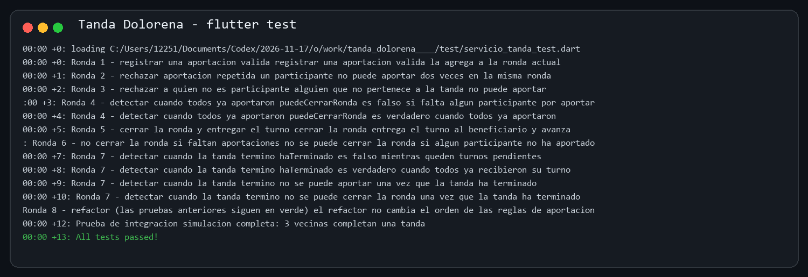

# tanda_dolorena

Aplicación Flutter para administrar una tanda dolorense mediante reglas de negocio desarrolladas con TDD.

## Ejecutar

```bash
flutter pub get
flutter test
flutter run
```

Las rondas del proceso TDD están documentadas en [ETAPAS.md](ETAPAS.md).

## Evidencia de pruebas

La suite comprueba aportaciones, participantes, cierre de rondas, turnos y finalización de la tanda. Resultado: **13 pruebas aprobadas**.

### Ciclo TDD: rojo a verde

La captura roja reproduce de forma controlada el momento previo a implementar una regla; la verde corresponde a la suite final del repositorio.

| 🔴 Prueba que solicita código faltante | 🟢 Implementación terminada |
|---|---|
|  |  |
