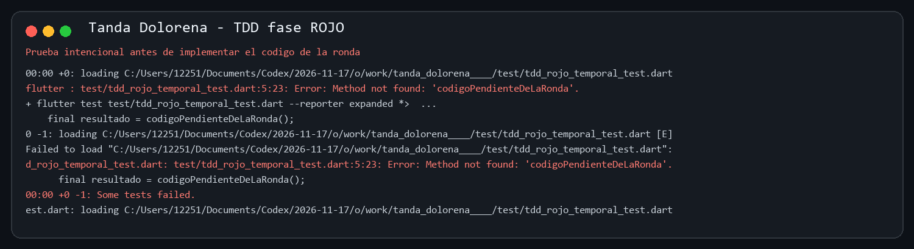
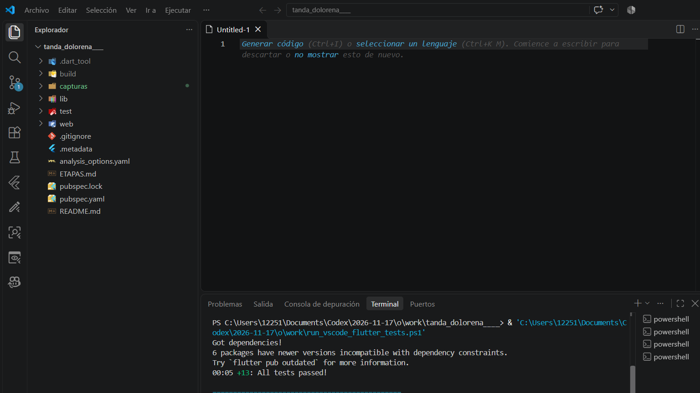

# Tanda Doloreña

Aplicación de Flutter para llevar el control de una tanda. Guarda participantes, aportaciones, rondas y turnos.

## Cómo ejecutarlo

```bash
flutter pub get
flutter run
```

Para ejecutar las pruebas:

```bash
flutter test
```

## Todas las pruebas

Se ejecutaron las siguientes 13 pruebas:

1. Una aportación válida se agrega a la ronda actual.
2. Una persona no puede aportar dos veces en la misma ronda.
3. Una persona que no pertenece a la tanda no puede aportar.
4. La ronda no puede cerrarse si falta una aportación.
5. La ronda puede cerrarse cuando todos aportaron.
6. Cerrar la ronda entrega el turno y avanza a la siguiente.
7. No se puede cerrar si algún participante no ha aportado.
8. La tanda no termina mientras queden turnos pendientes.
9. La tanda termina cuando todos recibieron su turno.
10. No se puede aportar después de terminar la tanda.
11. No se puede cerrar una ronda después de terminar la tanda.
12. El cambio interno del código conserva las reglas de aportación.
13. Tres participantes pueden completar una tanda completa.

Resultado final: **13 pruebas aprobadas**.

## Capturas reales de las pruebas

| Fase roja | Fase verde |
|---|---|
|  |  |
